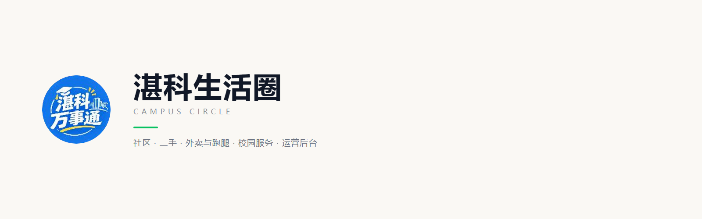
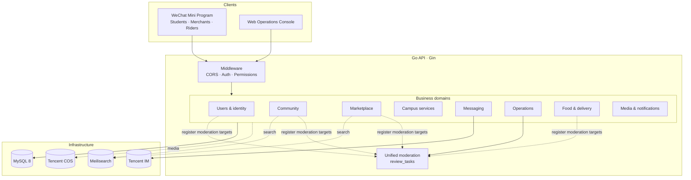

# Campus Circle

**湛科生活圈** — an all-in-one campus life platform for universities.

Community, second-hand marketplace, food ordering & errand delivery, campus services, messaging, 
and an operations console — one WeChat Mini Program plus one web admin.

**English** | [简体中文](README.zh-CN.md)

> **About this repository** — This is the public showcase of Campus Circle. The source code lives in a
> private repository; this repository contains only product descriptions, feature maps, and architecture
> overviews. Questions or a walkthrough? Open an issue here.

## Platform at a glance

| Surface | Who uses it | What it does |
| --- | --- | --- |
| WeChat Mini Program | Students | Community, second-hand trading, food & errand orders, campus services, direct messages |
| WeChat Mini Program | Merchants | Storefront & menu, delivery order creation, order handling, wallet & settlements |
| WeChat Mini Program | Riders | Claim delivery orders, track fulfillment, earnings & withdrawals |
| Web console | Operations / admins | Business dashboard, moderation, users & verifications, notifications & media, settlements, platform config |

Merchant and rider workspaces are unlocked by verified identity — no separate app to install.

## Features

### Community

- Rich posts with multiple images, editable after publishing
- Comments, likes, favorites, follows
- Feed browsing with full-text search
- Personal content management and media history
- Every interaction can be toggled independently by feature flag

### Second-hand marketplace

- Listings with multi-image galleries, categories, and editing
- Full-text search and favorites
- Listing comments and a direct-message conversation with the seller
- Listing lifecycle (available / delisted / sold) tied to moderation status

### Food ordering & errand delivery

- **Food ordering**: merchant catalog, menu, cart, WeChat Pay checkout, order tracking
- **Errand delivery**: merchant creates an order, a rider claims it, then pickup, drop-off, and confirmation, with support for externally sourced orders
- **Merchant side**: order intake, preparation & delivery handling, storefront and menu management, wallet
- **Rider side**: order board, daily volume and earnings, wallet and withdrawals
- **Platform settlements**: merchant wallets, rider wallets & earnings, payout queue, withdrawal processing, refund records, fund reconciliation

### Campus services

- Service entries: categories and navigation items that jump via appid + path
- Campus guides & information, frequently used tools
- Share settings: Mini Program card style and share entry configuration

### Messaging & notifications

- One-to-one direct messages over Tencent IM; the platform stores user mappings and conversation relations, never message bodies
- In-app interaction notifications
- Multi-channel delivery: in-app, WeChat subscription messages, service account, WeCom groups
- Notification console: delivery status, failed-message retries, channel health

### Identity & accounts

- WeChat login with student / merchant / rider / admin roles
- Student verification; merchant and rider identity applications (material upload, review, activation)
- Profile editing, appearance settings, blacklist
- In-app feedback and feature suggestions
- Official account binding, privacy and legal pages

### Operations console

| Group | Modules |
| --- | --- |
| Dashboard | Business overview: today's orders & revenue, moderation backlog, notification errors, delivery pipeline |
| Operations | Delivery & settlements (orders, wallets, earnings, payouts, withdrawals, refunds, reconciliation), notifications, media center |
| Content & users | Moderation center (one queue for all content types), community posts, listings, reports, merchant & rider verification, feedback, feature suggestions |
| Platform settings | Users & permissions, service entries, share settings, feature flags, legacy takeout |

The **moderation center** funnels posts, comments, listings, merchants, dishes, and reports into a single
queue flowing submitted, reviewing, approved or rejected, with rejection reasons delivered back to the author.

**Feature flags** allow per-module rollouts: any entry point can be turned off without affecting existing
orders, identities, or data.

## Architecture

The backend is organized by business domain: handlers deal only with input and output, services own state
machines, permissions, and moderation rules, and repositories exclusively own data access.

### Engineering safeguards

- **Enforceable domain boundaries** — a static checker turns architectural rules into failing checks
- **Media visibility gate** — only finalized and approved assets are served to clients
- **Traceable production builds** — version, commit, and build time are injected; untraceable builds refuse to start
- **One verification entry point** — boundary checks, cross-surface contract checks, type checks, and backend tests

## Technology stack

| Layer | Stack |
| --- | --- |
| Mini Program | Taro 4 · React 18 · Zustand · Tencent IM SDK |
| Web console | React 18 · Vite · TypeScript · Ant Design |
| Backend | Go · Gin · Gorm |
| Data | MySQL 8 · Meilisearch |
| Media & messaging | Tencent COS · Tencent IM |
| Infrastructure | Docker Compose · Nginx · systemd |

## License

Released under the [MIT License](LICENSE).
