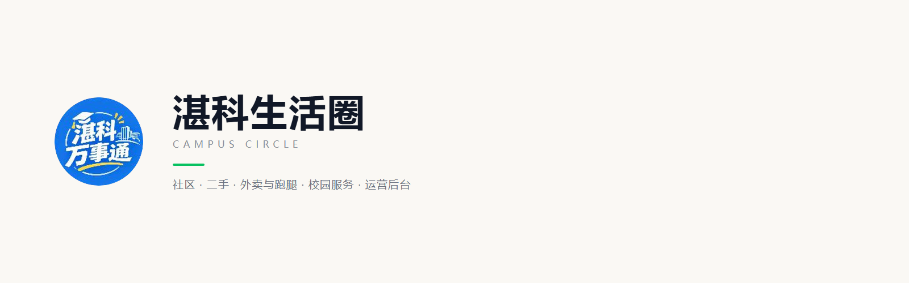
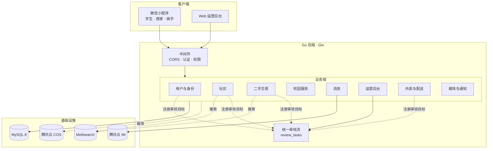

# 湛科生活圈 · Campus Circle

**面向高校的一站式校园生活平台。**

社区、二手市场、外卖与跑腿、校园服务、消息通知与运营后台， 
一个微信小程序加一个 Web 管理后台。

[English](README.md) | **简体中文**

> **关于本仓库** —— 这里是湛科生活圈的公开展示仓库，源代码位于私有仓库。本仓库只包含产品介绍、
> 功能地图与架构概览。想了解细节或体验演示，欢迎在本仓库提 issue。

## 平台形态

| 端 | 使用者 | 主要能力 |
| --- | --- | --- |
| 微信小程序 | 学生 / 普通用户 | 社区、二手交易、外卖与跑腿下单、校园服务、私信 |
| 微信小程序 | 商家 | 店铺与菜品、发跑腿单、订单处理、钱包与结算 |
| 微信小程序 | 骑手 | 抢单配送、履约进度、收入与提现 |
| Web 后台 | 运营 / 管理员 | 经营总览、内容审核、用户与认证管理、通知与素材、资金对账、平台配置 |

商家与骑手身份在审核通过后就地切换工作台，不需要另装应用。

## 功能地图

### 社区

- 图文帖子发布与编辑，支持多图
- 评论、点赞、收藏、关注
- 信息流浏览与全文搜索
- 个人内容管理与媒体历史
- 行为可按功能开关独立启停

### 二手市场

- 商品发布与编辑、多图展示、分类浏览
- 全文搜索、收藏
- 商品留言、联系卖家私信会话
- 商品状态流转（在售 / 下架 / 已售），与审核状态联动

### 外卖与跑腿

- **外卖**：商家目录、菜品、购物车、下单与微信支付、订单跟踪
- **跑腿配送**：商家发单 → 骑手抢单 → 取货 → 送达 → 确认的完整履约链路，支持外部订单接入
- **商家侧**：接单、出餐与配送管理、店铺与菜品维护、钱包
- **骑手侧**：抢单台、今日单量与收入、钱包与提现
- **平台结算**：商家钱包、骑手钱包与报酬、待打款队列、提现处理、退款记录、资金核对

### 校园服务

- 校园服务入口：分类与导航项（appid + path 跳转）
- 校园资讯与常用工具
- 分享设置：小程序卡片样式与分享入口配置

### 消息与通知

- 一对一私信（腾讯云 IM；平台只保存用户映射与会话关系，不落消息本体）
- 站内互动通知
- 多通道投递：小程序内通知、微信订阅消息、服务号、企业微信群
- 通知工作台：投递状态、失败重试、通道健康度

### 身份与账号

- 微信登录，学生 / 商家 / 骑手 / 管理员多角色权限
- 学生认证；商家与骑手身份申请（材料上传 → 审核 → 启用）
- 资料编辑、外观设置、黑名单
- 意见反馈与功能建议
- 官方公众号绑定、隐私与法务页

### 运营后台

| 分组 | 模块 |
| --- | --- |
| 工作台 | 经营总览：今日订单与收入、待审核积压、通知异常、配送流程分布 |
| 业务运营 | 配送与结算（订单、钱包、报酬、打款、提现、退款、资金核对）、消息通知、素材中心 |
| 内容与用户 | 审核中心（统一审核队列）、社区内容、二手商品、举报处理、商家骑手认证、意见反馈、功能建议 |
| 平台设置 | 用户与权限、服务入口、分享设置、功能开关、旧版外卖 |

**审核中心**把帖子、评论、商品、商家、菜品、举报等不同类型内容收进同一个队列，按
「提交 → 审核中 → 通过 / 驳回」流转，驳回可填理由并通知作者。

**功能开关**支持按模块灰度：任何入口都可以在不影响既有订单、身份和数据的前提下关闭。

## 技术架构

后端按业务域划分模块：handler 只负责输入输出，service 承载状态机、权限与审核规则，repository 独占数据访问。

### 工程保障

- **域边界可执行** —— 静态检查把架构约束变成会失败的检查
- **媒体可见性门禁** —— 只对外放行「终态 + 已审核」的媒体资源
- **生产构建可追溯** —— 版本、提交号、构建时间注入二进制，不可追溯的构建拒绝启动
- **统一校验入口** —— 边界检查、多端契约检查、类型检查与后端测试一次跑完

## 技术栈

| 层 | 技术 |
| --- | --- |
| 小程序 | Taro 4 · React 18 · Zustand · 腾讯云 IM SDK |
| Web 后台 | React 18 · Vite · TypeScript · Ant Design |
| 后端 | Go · Gin · Gorm |
| 数据 | MySQL 8 · Meilisearch |
| 媒体与消息 | 腾讯云 COS · 腾讯云 IM |
| 基础设施 | Docker Compose · Nginx · systemd |

## 许可证

本项目基于 [MIT 许可证](LICENSE) 发布。
